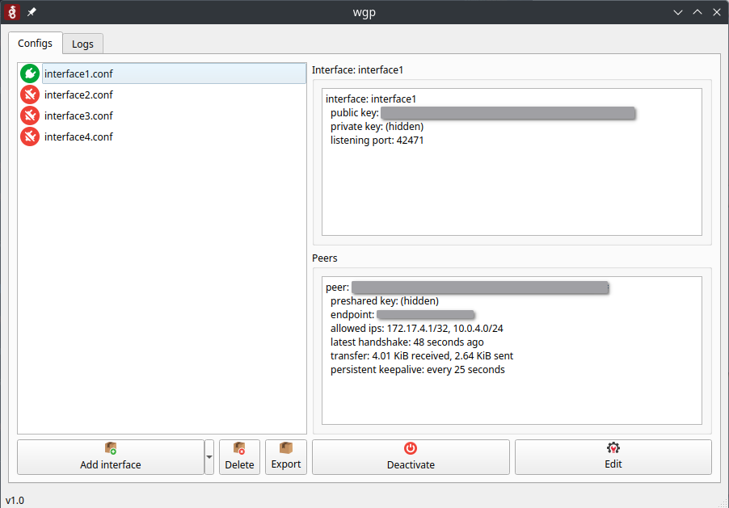
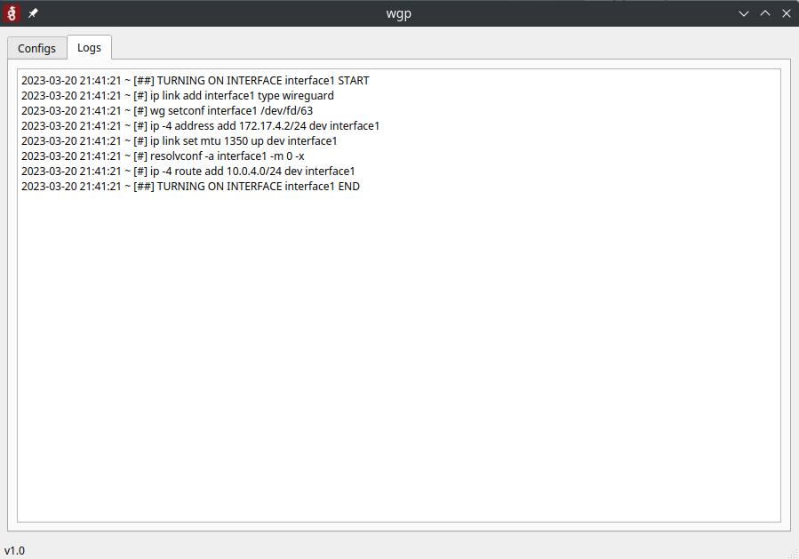
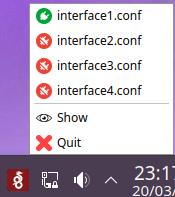

# Wireguard gui python (WGP)

Wireguard client for Linux users, wrote in Python 3.

## Installation

### Script

You can use the `install.sh` script.

```
bash -c "$(curl -fsSL https://raw.githubusercontent.com/gary113/wireguard-gui-python/master/install.sh)"
```

It will:

1. Clone this repository to `/opt/wireguard-gui-python`.
2. Install systems requirements from `system-requirements.txt`.
3. Install Python requirements from `requirements.txt` in a virtual environment.
4. Copy wgp.desktop to /usr/share/applications (Applications menu).

*Feel free to modify the script as you need.*

### Manual

1. Install requirements indicated in `system-requirements.txt` with your system's package managger and `requirements.txt` with pip.
2. Copy the project directory wherever you want.
3. Run with run.sh script or wgp.desktop located in resources folder, after update project directory.

## Usage

### How to run

#### Desktop file

If you used the install script, you will have a desktop file on your applications menu. Just click it, it will ask you for your sudo password.


#### Manual

Run wgp executing `run.sh` **with admin privileges**:
```
$ cd wireguard-gui-python
$ sudo ./run.sh
```

### About the usage

- This client is similar to the Windows client.
- It reads configurations from `/etc/wireguard`.
- You can modify certain configurations using the `.env` file.
- The interface language can be changed at any time from the `Language` submenu, and is remembered across restarts.
- You can perform the following actions:
  - Add Wireguard interfaces.
  - Delete interfaces (Delete files in `/etc/wireguard`).
  - Export interfaces to a zip file.
  - Import interfaces from a zip file.
  - Activate/deactivate Wireguard interfaces.
  - Edit Wireguard configuration files (roll back configuration if not valid).

### Interface language

The interface can be displayed in:

- **English**
- **中文** (`zh_CN`)
- **System default**: follow the language of the system.

The language is selected from the `Language` submenu of the `Add interface` menu (top left of the main window). The change is applied immediately — all the windows, menus and dialogs are retranslated without restarting the application — and it is stored with QSettings (`~/.config/wireguard-gui-python/wgp.ini`), so it is restored on the next start.

To add a new language:

1. Add its code and native name to `SUPPORTED_LANGUAGES` in `utility/language.py`.
2. Create `translations/wgp_<code>.ts` from `translations/wgp.ts`, translate the strings and compile it:
   ```
   lrelease translations/wgp_<code>.ts -qm translations/wgp_<code>.qm
   ```
3. Optionally copy the Qt translations of the language (`qt_<code>.qm`, `qtbase_<code>.qm`, ...) in the `translations` directory to also translate the standard widgets (buttons of the dialogs, file dialogs, ...).

Every `.qm` file named `*_<code>.qm` found in `translations` is loaded when that language is selected.

### Screenshots

- Config files:



- Wireguard logs:



- Tray menu:



### License

This project is licensed under the GNU General Public License v3.0. See the [LICENSE](LICENSE) file for details.
